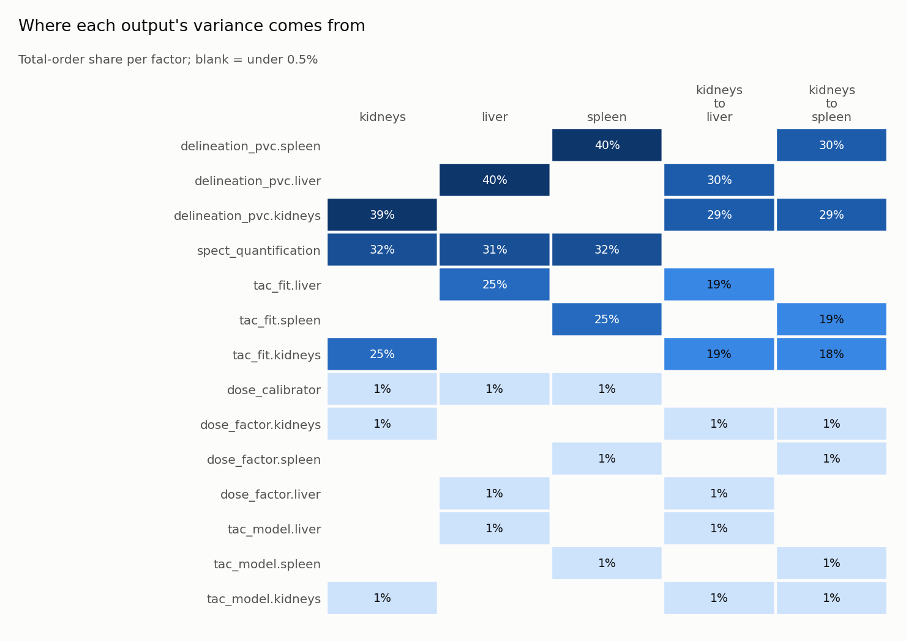

# RadioNuclide Uncertainty Lab

**Uncertainty-aware nuclear medicine dosimetry.**
Transparent, reproducible uncertainty propagation for internal dosimetry calculations, with
sensitivity rankings and physically meaningful error budgets, for one organ or several.

`Python` · `Monte Carlo` · `SciPy` · `NumPy` · `Statistical modelling`

> **Research software.** Not validated for clinical decision-making. The shipped scenario is
> assembled from published open-access values (see [Data and benchmarks](#data-and-benchmarks))
> and is not a patient.

---

## Why this exists

A patient dose of "3.4 Gy" is not a result until it carries an uncertainty, and the uncertainty is
only useful if you can say **where it comes from**. For an internal-dosimetry (MIRD-style)
calculation this project answers:

1. **How uncertain is each organ dose?** Monte Carlo propagation of every input distribution.
2. **Which inputs matter?** Rank-based screening, then variance-based (Sobol') sensitivity.
3. **What can I do about it?** An *error budget*: variance shares per physical source
   (calibration, quantification, curve fit, dose factor, …) that shows whether better imaging,
   more time points or a patient-specific mass would actually tighten the result.
4. **How do the organs relate?** Doses share systematic errors. They are correlated, and their
   *ratios* are insensitive to the shared part. The multi-organ model keeps that structure.

Everything is driven by one YAML file that lists each uncertain input, its distribution and its
**source**, so an analysis can be reviewed, versioned and re-run bit-for-bit.

## Quickstart

```bash
pip install -e ".[dev]"      # numpy, scipy, pyyaml (+ matplotlib, pytest, ruff)
radionuclide-uncertainty-lab run examples/configs/lu177_dotatate_multi_organ.yaml --out results/lu177
```

(`rnulab` is a short alias for the same command; `python -m RadioNuclide_Uncertainty_Lab.cli` also works.)

```
177Lu-DOTATATE multi-organ dose, one 7.4 GBq cycle (reference scenario)
  kidneys                    3.41 ± 0.41    Gy   (95% interval 2.672–4.267; CV 12.0%)
  liver                     3.996 ± 0.485   Gy   (95% interval 3.109–5.008; CV 12.1%)
  spleen                    4.514 ± 0.547   Gy   (95% interval 3.511–5.639; CV 12.1%)
  kidneys_to_liver         0.8618 ± 0.12         (95% interval 0.6506–1.124; CV 14.0%)
  kidneys_to_spleen         0.763 ± 0.107        (95% interval 0.5752–0.9934; CV 14.0%)
  largest sources for kidneys: delineation_pvc.kidneys 39%, spect_quantification 32%, tac_fit.kidneys 25%
  ...
wrote 19 files to results/lu177/
```

Three things worth noticing in that output:

- Each organ's **12.0–12.1 %** is the published kidney uncertainty budget (Staanum et al. 2021, which
  quotes 13 % after rounding each term up) reproduced by Monte Carlo.
- The **ratios are *less* certain than the doses (14.0 %)**: calibration errors are shared by the
  organs and cancel in a ratio, leaving only the organ-specific terms, once for each organ.
- The shared SPECT/dose-calibrator terms account for 33 % of each dose's variance, which is also
  the **correlation between organ doses** (0.33–0.34).
- **Cross-organ dose is included** (S-values from the MIRDcalc database, see below): it adds 1.8 % to
  the kidney dose, matching the EANM recommendations' "about 2 %".

The run writes `result.json`, `report.md` and figures. The most useful one is the factor × output
matrix:



Check the published data the scenario relies on (this is also a CI step):

```bash
radionuclide-uncertainty-lab check-data     # 131 claims, 40 checks: 34 PASS, 6 KNOWN_CONFLICT
```

From Python:

```python
from RadioNuclide_Uncertainty_Lab import analyze, load_config

cfg = load_config("examples/configs/lu177_dotatate_multi_organ.yaml")
a = analyze(cfg.model, cfg.run, config_sha256=cfg.sha256)
a.summaries["kidneys"]  # mean, SD, interval, skewness, GSD
a.budgets["kidneys"].lines  # per-factor S1 / ST with confidence intervals
a.matrix  # factors x outputs
```

More: [`examples/01_python_api.py`](examples/01_python_api.py);
[`examples/02_fit_to_dose.py`](examples/02_fit_to_dose.py) (fit time-activity data, keep the fit's
published correlation, write a custom model function).

## How it works

```
 config.yaml ──► InputSpace ──► sampling ──► model.func ──► UncertaintyResult ──┬─► summaries
 distributions,   factors &      Sobol' /     vectorised,     inputs + outputs  ├─► rank_sensitivity (PRCC, SRC)
 groups, source,  Gaussian       LHS /        several                           │
 constants, seed  copula         random       outputs                           │
                                                                                 │
                            Saltelli/Jansen design ─► sobol_all ─► error_budget ─┴─► report.md / .json / .png
                            (evaluated once, all outputs)         budget_matrix
```

Key ideas (details in [`docs/design.md`](docs/design.md) and
[`docs/methodology.md`](docs/methodology.md)):

- **Groups are the unit of attribution.** Parameters sharing a `group` form one *factor*. Factors
  are independent; correlation is only allowed *inside* a factor. A correlated block (e.g.
  amplitude and rate of one fitted curve) is one budget line, not two misleading ones.
- **Shared vs organ-specific errors are explicit.** `activity_scale.<label>` multiplies every
  organ's time-integrated activity; `<organ>.activity_scale.<label>` only that organ's (likewise
  `dose_scale`). One `{organ}` template line expands per organ.
- **Two sensitivity tiers.** Rank-based screening is free (reuses the Monte Carlo run). Sobol'
  indices cost `n·(2+K)` evaluations, give a variance decomposition including interactions with
  bootstrap CIs, and are computed for all outputs from one design.
- **Provenance in every report:** config SHA-256, seed, sampling method, sample sizes, versions,
  the published claims and the S-value source file the analysis relied on.
- **Conflicting data is excluded by machine, not by eye** (next section).

## Data, robustness and benchmarks

The shipped scenario uses **only published values**, each traceable: the kidney uncertainty budget
(Staanum 2021), organ dose cohorts (Santoro 2018), the EANM uncertainty guidance example (Gear
2018), the EANM Lu-177 recommendations (Sjögreen Gleisner 2022), and **S-values for self and
cross-organ dose from the MIRDcalc database** (ICRP 110 adult male phantom, ICRP 107 decay data).
Derivations and assumptions are in [`docs/data-sources.md`](docs/data-sources.md).

**Making data robust.** Transcribing numbers from papers fails in three ways: a source contradicts
itself, two sources disagree, or a number is mistyped. All three are caught automatically:

- Every published number is a *claim* with its location ([`claims.yaml`](src/RadioNuclide_Uncertainty_Lab/data/claims.yaml));
  config parameters cite their claim with `claim:` and the loader refuses a distribution that does
  not realise it, so values cannot drift.
- *Checks* relate claims to each other, to arithmetic and to physics (S-value reciprocity, energy
  conservation, agreement between independent codes, bounds from primary nuclear data). A failing
  check **excludes** the claims it
  names: they raise `ExcludedClaimError` and a config using them will not load.
- Six discrepancies in the sources are already caught this way (e.g. an abstract that swaps a mean
  and a median; a listed uncertainty that its own table contradicts; OpenDose's liver self term, which
  its paper explains). They are declared `expect: conflict`: excluded, and flagged if upstream ever
  corrects them.
- **Cross-organ S-values have an independent second source.** On the ICRP 110 female phantom, MIRDcalc
  agrees with IDAC-Dose 2.1 within 0.40 % and with OpenDose within 0.52 % for a liver source (six
  targets, four orders of magnitude). The scenario's male phantom is covered by reciprocity (0.2 %),
  energy conservation, and the EANM's "about 2 %" (1.80 %).
- **Nuclear data come from the primary evaluation** (LNHB DDEP, revised 2025: T½ = 6.6443(9) d), and the
  ICRP 107 and NNDC electron energies are checked against bounds built from its emission tables. A
  check ties `nuclides.py` to the claims, so a stale value is an error.
- The S-value dataset carries its provenance (archive, file CRC-32/SHA-256, database version) and is
  regenerated by [`tools/extract_mirdcalc_svalues.py`](tools/extract_mirdcalc_svalues.py); the model
  refuses a dataset whose checks do not all pass.
- Every analysis ends with **diagnostics** for ways it can mislead: a normal marginal that reaches
  zero, wide Sobol' confidence intervals, inconsistent indices, heavy tails, missing seed.

> **Terms of the S-value source.** MIRDsoft states the database may be used for personal and
> noncommercial use and names no open licence. This repository keeps only small organ S-value
> matrices (4 and 8 regions) and masses, with citation, and the tool to regenerate them from your own
> copy. Check the terms before
> redistributing; see [`docs/data-sources.md`](docs/data-sources.md#4-terms-of-the-s-value-source).

Published results the test suite reproduces ([`docs/benchmarks.md`](docs/benchmarks.md)):

| Published result | Source | This package |
|---|---|---|
| Kidney dose uncertainty, 3-SPECT: 13 % (12.1 % before rounding up) | Staanum 2021 Table 2 | 12.0 % by Monte Carlo |
| Liver lesion: 26.1 Gy, 37.6 % | Gear 2018 Table 13 | 26.06 Gy, 37.58 % (first order, from their inputs) |
| Pancreatic lesion: 21.7 Gy, 15.6 % | Gear 2018 Table 13 | 21.75 Gy, 15.58 % |
| Fit term of the TIA: 15.1 % (r(A0, λ) = 0.89) | Gear 2018 Tables 7–9 | 14.3 % Monte Carlo; 42 % if the correlation is ignored |
| Self S-values 0.204 / 0.0376 / 0.377 mGy/MBq/h | Gleisner 2022 (IDAC-Dose 2.1) | MIRDcalc agrees within 0.4 % (independent code) |
| Lu-177 S-values, liver source, female phantom (cross terms) | OpenDose 2020 Table 1 (OpenDose and IDAC-Dose 2.1) | MIRDcalc within 0.52 % / 0.40 % for all six targets |
| Rest-of-body share of kidney dose "about 2 %" | Gleisner 2022 | 1.8 % from the cross-organ S-values |

plus closed-form checks (Ishigami function, multiplicative lognormal model with interactions,
additive model with a correlated group).

## Repository layout

```
radionuclide-uncertainty-lab/
├── src/RadioNuclide_Uncertainty_Lab/
│   ├── distributions.py   lognormal(median, gsd), truncated normal, …; config -> distribution
│   ├── inputs.py          Parameter, factors (groups), Gaussian-copula correlation
│   ├── sampling.py        scrambled Sobol' / Latin hypercube / random, one seed for everything
│   ├── model.py           UncertainModel: input space + vectorised function, one or more outputs
│   ├── propagation.py     Monte Carlo propagation + per-output summaries
│   ├── sensitivity.py     rank_sensitivity (Spearman/PRCC/SRC), sobol_all / sobol_indices
│   ├── budget.py          error budget per output + factor x output matrix
│   ├── kinetics.py        effective rate, TIA, mono-exp fit -> correlated lognormal parameters
│   ├── mird.py            D = A~ × S, self-dose S-value, unit constants
│   ├── nuclides.py        sourced Lu-177 decay data (add others only with a citation)
│   ├── refdata.py         packaged S-value datasets: provenance + load-time validation
│   ├── data/              lu177_adult_male/female.json (S-values, masses), claims.yaml (131 claims, 40 checks)
│   ├── datacheck.py       claim registry, consistency checks, automatic exclusion
│   ├── diagnostics.py     run-time warnings for analyses that can mislead
│   ├── models.py          multi_organ: sources/targets, self+cross S, shared/specific factors
│   ├── config.py          YAML -> model + run settings (strict; {organ} templating)
│   ├── workflow.py        analyze(): propagation + screening + Sobol' + budgets in one call
│   ├── report.py          markdown / JSON with provenance
│   ├── plots.py           intervals, budget matrix, per-output budget / ranking / distribution
│   └── cli.py             run | validate | check-data | models
├── tools/                 extract_mirdcalc_svalues.py: regenerate the S-value dataset from source
├── examples/              reference scenario YAML + two runnable scripts
├── tests/                 191 tests incl. published-result, analytic, data-integrity and mutation tests
├── docs/                  design · methodology · data-sources · benchmarks · roadmap
└── .github/workflows/     CI: ruff + pytest on Python 3.10–3.13
```

## Scope and limits

Modelled: several source/target organs (each source organ is also a target), per-organ kinetics
(mono-exponential, or a direct TIA coefficient), **self- and cross-organ S-values from one validated
phantom dataset**, mass scaling, shared and organ-specific measurement errors, derived ratio outputs;
parametric (input) uncertainty.

Not modelled yet, stated plainly: remainder of body, tumours (the lesion power-law S(m) is
supported and benchmarked; the MIRDcalc file also holds sphere S-values), red marrow (in the
dataset, but no kinetics), bi-exponential kinetics, structural/model-form uncertainty and
inter-patient variability. Liver and spleen reuse the kidney measurement budget as a stated
assumption. See [`docs/roadmap.md`](docs/roadmap.md).
The budget quantifies the *measurement chain of one patient's estimate*, not the spread between
patients.

## Development

```bash
pip install -e ".[dev]"
pytest            # 191 tests, ~8 s
radionuclide-uncertainty-lab check-data
ruff check . && ruff format --check .
```

## License and citation

Apache License 2.0, see [`LICENSE`](LICENSE) and [`NOTICE`](NOTICE). The licence covers the code and
original documentation; the bundled S-value data and the published numbers keep their sources' terms
(see `NOTICE` and [`docs/data-sources.md`](docs/data-sources.md)). Citation metadata is in
[`CITATION.cff`](CITATION.cff). If you use
the shipped scenario or benchmarks, please also cite the original papers listed in
[`docs/data-sources.md`](docs/data-sources.md).
